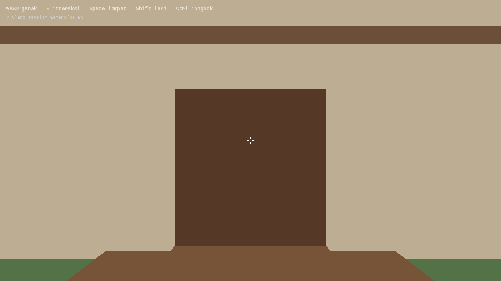

# Hello Neighbor
## built with Rust + macroquad

Remake 3D first-person Hello Neighbor versi minimal: satu rumah dua lantai, kunci, pintu keluar, dan tetangga yang berpatroli, mencurigai, lalu mengejar.

Semua visual dibuat dari primitif macroquad (`draw_cube`), tanpa asset gambar/3D.



## Build & jalankan

```sh
cd app
cargo build
cargo run
```

## Kontrol

| Tombol | Aksi |
| --- | --- |
| WASD | Gerak |
| Mouse | Lihat sekeliling |
| Space | Lompat |
| Shift | Lari |
| Ctrl | Jongkok |
| E | Interaksi (ambil kunci/kotak, buka pintu, lepas kotak) |
| R | Ulang setelah menang/kalah |

## Tujuan

Ambil kunci di lantai 1, lalu buka pintu depan untuk kabur. Jangan sampai tertangkap tetangga.
