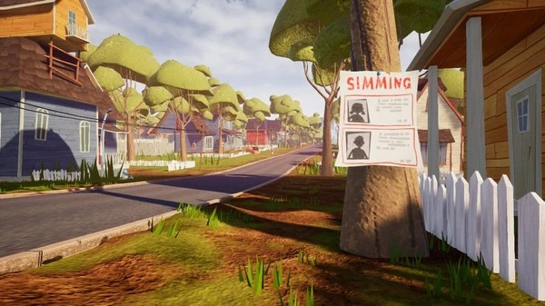

# Neighbour on Linux
## built in pure Rust and macroquad

lightweight 3D first-person Hello Neighbor remake with two-story house, a key, an exit door, and a neighbor who patrols, grows suspicious, then chases.

planned to be compiled as Flatpak package and able to run smoothly on every distros

All visuals are built from macroquad primitives (`draw_cube`), with no image or 3D assets.



## Build & run

```bash
cd app && cargo build && cargo run
```

## Controls

| Key | Action |
| --- | --- |
| WASD | Move |
| Mouse | Look around |
| Space | Jump |
| Shift | Sprint |
| Ctrl | Crouch |
| E | Interact (take key/box, open door, drop box) |
| R | Restart after winning or losing |

## Objective

Take the key on the first floor, then open the front door to escape. Don't get caught by the neighbor. 
