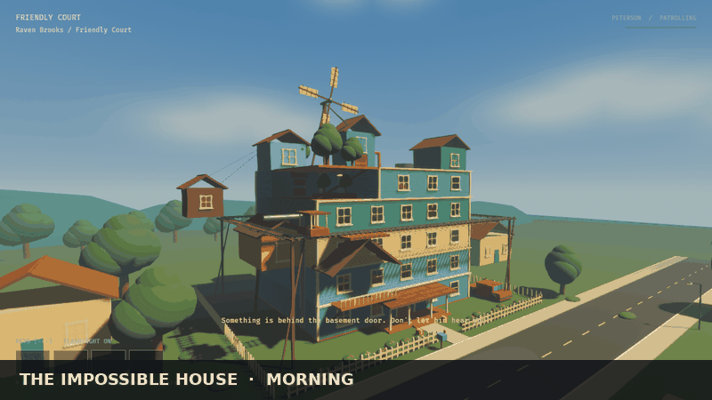

# Hello Neighbor — The Impossible House

An unofficial, original **Rust + Bevy 0.20.1** stealth-mystery fan prototype inspired primarily by the full-release Act 3 house. It is a procedural, playable blockout—not a complete remake or a verified reconstruction of the original floor plan. The game includes no original game assets.

Explore a six-level impossible house, climb to its rooftop machinery, and follow the colored-key trail into a large underground maintenance labyrinth. A continuous morning-to-night cycle, reactive neighbor, environmental audio, and an original adaptive score shape each attempt.

> **Linux desktop:** Native Cargo builds and a verified Flatpak bundle are supported. The Flatpak uses the Freedesktop 26.08 runtime.

## Screenshots

<p align="center">
  <a href="docs/screenshots/animated-gallery.gif">
    
  </a>
</p>

## What you can play

- First-person walking, sprinting, crouching, jumping, step-up collision, flashlight, and carry/drop/throw box interactions.
- Six connected house levels, a rooftop tower gallery, stairs, surrounding neighborhood, and procedural neighbor with patrol, hearing, occluded sight, investigation, chase, search, and capture memory.
- A working progression: **blue key → archive → green key → greenhouse → red key → tower → stop windmill → disable generator → retrieve freezer keycard**.
- Use the crowbar and keycard to descend into a **48.4 × 48.4 m, 12-chamber underground labyrinth**. Read the entrance board, open the Tab map, restore three circuits, collect the service key, and escape through the service exit.
- Thirty-seven responsive household targets across 14 types, including lamps, television, telephone, drawers, cupboard, books, paintings, sink, shower, kettle, mailbox, doorbell, and tower dial. Use **E** while aiming at an object.
- A two-minute default day/night cycle, environmental and machinery sound layers, and an original adaptive score with 13 themes and two arrangements per theme.
- Compact English HUD, help/objectives, basement signage and map, procedural character animation, water/steam/dust effects, and a responsive low-graphics preset.

The prototype does **not** yet include the original hot-crowbar/magnet/shower puzzle, a rideable trolley, wardrobe hiding, fear challenges, selectable inventory, keyhole peeking, full menus/settings, or final authored assets. The trolley starts and stops but is not rideable; the cupboard is a clue interaction, not a hiding place. The custom kinematic collision controller is designed for this axis-aligned blockout, not general rigid-body simulation.

The house and implementation boundaries are described in [HOUSE_DESIGN.md](docs/HOUSE_DESIGN.md), [BASEMENT.md](docs/BASEMENT.md), and [ARCHITECTURE.md](docs/ARCHITECTURE.md). [Reference research](docs/HELLO_NEIGHBOR_RESEARCH.md) distinguishes the released game from Alpha versions. Native test coverage, current screenshots, and profiling caveats are in [POLISH_CHECKS.md](docs/POLISH_CHECKS.md) and [PERFORMANCE.md](docs/PERFORMANCE.md).

## Run the Flatpak

The package can be built as a local single-file `.flatpak` bundle. The x86_64 bundle built on November 21, 2026 is **14,432,864 bytes (13.77 MiB)**—well below both 500 MB and 1 GB. Its installed application payload is 75,635,712 bytes (about 75.6 MB); the Freedesktop runtime is a separate Flatpak dependency and is not included in the bundle size. On the tested setup, the build used **Flatpak 1.18.4**, `flatpak-builder` **1.4.12**, and the **Freedesktop 26.08** runtime/SDK with its `rust-stable` extension.

Install the runtime and SDK extension if they are not already present:

```sh
flatpak install --user flathub org.freedesktop.Platform//26.08
flatpak install --user flathub org.freedesktop.Sdk//26.08
flatpak install --user flathub org.freedesktop.Sdk.Extension.rust-stable//26.08
```

Then build, install, and launch the bundle:

```sh
./build-flatpak.sh
flatpak install --user --bundle ./org.helloneighbor.HelloNeighbor.flatpak
flatpak run org.helloneighbor.HelloNeighbor
```

The script vendors the lockfile-pinned Cargo dependencies on the host and compiles them offline inside the Flatpak SDK. It also exports `.flatpak-repo/` and creates `org.helloneighbor.HelloNeighbor.flatpak` in the project root. To launch the packaged diagnostic without opening the game window:

```sh
flatpak run --command=hello-neighbor org.helloneighbor.HelloNeighbor --self-test
```

To uninstall the per-user app:

```sh
flatpak uninstall --user org.helloneighbor.HelloNeighbor
```

## Build and run natively

Requires Rust **1.97.1+**, a Vulkan-capable Linux graphics driver, and development libraries for Wayland/X11 and ALSA. The application enables both X11 and Wayland window backends.

```sh
cd app
cargo run --locked
```

For slower GPUs, use the opt-in **960×540 low-graphics** mode. It disables bloom and dynamic shadows without changing gameplay or physics:

```sh
cargo run --locked -- --low-graphics
```

No external game assets are needed. The previous Macroquad renderer is no longer used.

## Controls

| Input | Action |
| --- | --- |
| WASD / mouse | Move / look |
| Space | Jump |
| Shift | Sprint; hold while falling with umbrella to slow descent |
| Ctrl or C | Crouch |
| E | Pick up, unlock, operate a machine, or use the tower ladder |
| Q / G | Drop / throw a carried box |
| F | Toggle flashlight |
| H | Show/hide objective and detailed control guide |
| Tab | Open/close underground map after reading the entrance board |
| M | Mute/restore music; ambience and effects remain separate |
| Esc / left click | Pause and release cursor / resume |
| R | Retry after capture or completion |
| F10 | Exit |

## Checks and screenshot capture

From the repository root:

```sh
cargo fmt --manifest-path app/Cargo.toml --check
cargo clippy --manifest-path app/Cargo.toml --locked --all-targets -- -D warnings
cargo test --manifest-path app/Cargo.toml --locked
cargo build --manifest-path app/Cargo.toml --locked
./app/target/debug/hello-neighbor --self-test
```

The suite covers puzzle progression, the underground navigation graph and controls, retry/collision behavior, household interactions, sound/music logic, and the optimized occlusion-ray broad phase. Native render smoke checks and the performance replay are described in [PERFORMANCE.md](docs/PERFORMANCE.md).

The binary also supports reproducible render captures and an opt-in encounter replay:

```sh
./app/target/debug/hello-neighbor --frames 120 --quiet
./app/target/debug/hello-neighbor --overview --time 9 --screenshot morning.png --quiet
./app/target/debug/hello-neighbor --view basement --showcase --screenshot basement.png --quiet
./app/target/debug/hello-neighbor --profile-encounter /tmp/encounter.csv --quiet
```

`--view` accepts `workshop`, `archive`, `station`, `tower`, `kitchen`, `living-room`, `bathroom`, `gallery`, `neighbor`, `basement`, `basement-lab`, or `basement-vault`. `--showcase` activates household props for inspection captures only and requires both `--view` and `--screenshot`. Captures use a fixed 1280×720 target; `--low-graphics` does not reduce screenshot resolution.

Useful options include `--time HOUR` (initial simulated hour in `[0,24)`), `--day-length SECONDS` (minimum 24; default 120), `--controls` (start with the H guide open), and independent `--music-volume`, `--ambience-volume`, and `--effects-volume` values in `[0,1]`. `--quiet` disables audio-device initialization for silent tests and captures.

## Flatpak and release status

- Flatpak manifest: [`org.helloneighbor.HelloNeighbor.yml`](org.helloneighbor.HelloNeighbor.yml)
- AppStream metadata: [`org.helloneighbor.HelloNeighbor.metainfo.xml`](org.helloneighbor.HelloNeighbor.metainfo.xml)
- Build, install, packaged self-test, and 120-frame windowed smoke validation all passed; details are in [PERFORMANCE.md](docs/PERFORMANCE.md).
- Bundle file: `org.helloneighbor.HelloNeighbor.flatpak` (generated locally; do not commit the binary—attach it to a GitHub Release).

## License and attribution

Hello Neighbor and its characters belong to their respective owners. This is an unofficial fan prototype, not affiliated with or endorsed by Dynamic Pixels or tinyBuild. Procedural geometry and synthesized sounds are original to this prototype; original game assets are not included. Project licensing is MIT; metadata licensing for the app icon is CC0.
