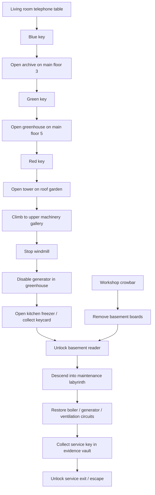

# The impossible house — design and playable blockout

This is the priority design document for the Bevy rebuild. The house is the main character: a suburban home that has been extended into a machine nobody should be living inside. Its shape should communicate obsession, secrecy and improvised engineering before the player reaches the fence.

The reference is primarily the **full-release Hello Neighbor Act 3** house. This is an original procedural fan blockout informed by that reference, **not a verified replica of its floor plan or puzzles**. Reference findings and version distinctions are in [HELLO_NEIGHBOR_RESEARCH.md](HELLO_NEIGHBOR_RESEARCH.md).

[Open the house blueprint](house-blueprint.svg) for an overview of the six main levels and top-machine dependency.

## The player’s question

“Why does a family house need a railway, a locked greenhouse and a wind-powered machine above the roof—and what are they keeping cold downstairs?”

Every important landmark must answer one small question while opening another. Keys connect rooms; cables, pipes and sounds explain those connections. Weirdness should become understandable through exploration instead of being a collection of unrelated props.

## Architecture and silhouette

- A recognizable blue clapboard home, cream window trim and a porch anchor the ground floor in ordinary suburbia.
- Five enclosed main floors climb above that home. A sixth main level is a roof garden, with a locked watchtower rising still higher and an upper machinery gallery inside it.
- Yellow and red cantilevered annexes interrupt the blue mass. Thin diagonal braces and overlong stilts make their weight look wrong.
- An elevated railway wraps around the building. A trolley has its own station and control console.
- A little shed hangs beside the upper house on cables. Its inaccessible position makes it a destination to wonder about rather than a random floating box.
- Trees grow indoors and on the roof. Their roots, planters and proximity to machinery suggest the house has swallowed its garden.
- A huge windmill, a water tank, mismatched gables, exposed drainage, aerials and a narrow tower break the skyline at different heights.
- The highest functional space is the tower’s **listening and dynamo gallery**, linked mechanically to the windmill and electrically to the generator below.

The current blockout uses shared primitive meshes/materials. Most doors and interactable props are separate entities. Shared procedural surface maps now add wood grain, roof courses and cloth weave. Sculpted walls, authored textures, structural wear, roof shapes and bespoke models remain future art passes; primitive detail is not a claim of final visual fidelity.

## House register

“Working” means an interaction changes gameplay. “Blockout” means geometry exists. “Planned” means a design intention, not a shipped feature.

| Space | Identity and small details | Purpose / mystery connection | Current state |
| --- | --- | --- | --- |
| Friendly Court | Road, curbs, sidewalks, neighboring homes and trees | Gives a readable boundary between safety and intrusion | Blockout; crossing back to the street breaks detection |
| Front yard | Crooked pickets, mailbox with raised red flag, red car | Frames the approach; side paths offer alternate routes | Fences and car collide; mailbox flag and letter respond to E; porch doorbell attracts attention |
| Covered porch | Narrow posts, shallow steps, sagging-looking roof | A deceptively ordinary invitation | Traversable |
| Living room | Blue sofa, striped rug, CRT and aerials, telephone table | Blue key begins the locked-room trail | Working key pickup, TV/phone distractions, and toggleable floor lamp |
| Kitchen | Tall fridge/freezer, cabinets, sink, exposed faucet, red kettle | Final return destination after the rooftop power puzzle | Working freezer/keycard, sliding drawers, faucet with water, kettle with steam, and ceiling lamp |
| Basement landing | Black metal door, electronic reader, three timber boards and hazard marks | Central objective visible before it can be opened | Working crowbar + keycard gate; descending stairs lead into the underground labyrinth |
| Main stairwell | Alternating flights, separate lanes, pale nosings and handrails | Reliable navigation spine connecting six levels | Collision-tested route; neighbor shares the stairs |
| Workshop | Workbench, loaded shelves, mismatched books, red crowbar | Supplies the tool for basement boards | Working crowbar pickup |
| Peterson’s bedroom | Dark frame, blue quilt, pillow and oversized headboard | Domestic remnants distinguish the owner from a generic monster | Furnished blockout with a working bedside lamp; story dressing planned |
| Bathroom | Old bathtub, tall shower riser, exposed plumbing | Future hot-crowbar cooling circuit | Working shower valve, water effect and sound; crowbar cooling not implemented |
| Sealed blue archive | Blue door, shelves, key table; surrounded by real walls | Blue key unlocks access to the green key | Working keyed door and key pickup |
| Crooked gallery | Uneven apple paintings, narrow runner and wallpaper motifs | Future painting-operated route / visual clue | Paintings tilt and reveal a clue; a separate painting puzzle remains planned |
| Child’s room | Small bed/dresser language, toy skateboard, an abandoned umbrella nearby | Suggests a family history; umbrella helps descent | Umbrella, dresser drawer and lamp working; arrangement puzzle planned |
| Wardrobe corner | Tall two-leaf wardrobe | Future threshold to a fear space | Cupboard doors open to reveal a note; hiding and fear challenge planned |
| Trolley station | Raised balcony, console, indicator lamps, rails and sleepers | Player can start/stop the mechanism from inside | Working trolley animation and console; riding/platform collision planned |
| Locked greenhouse | Green door enclosing the rear room, planters, indoor trees | Green key gives access to the red key and generator | Working keyed enclosure and red-key pickup |
| Generator room | Red cabinet, black grille, cable rising to the tower | Can only be disabled after the windmill is stopped | Working dependency and power state |
| Giant magnetic coil | Vertical iron core and stacked copper-colored rings | Future magnetic item-retrieval puzzle | Blockout; magnet behavior planned |
| Roof garden | Trees above living spaces, aerials, roof edges, exposed equipment | A brief open refuge before the final ascent | Traversable; falling is dangerous |
| Red tower entry | Red keyed door, tall blue walls, yellow ladder | Final lock in the colored-key chain | Working red lock and ladder interaction |
| Upper listening/dynamo gallery | Paired brass listening horns, dial, needle, shaft and power cable | Highest functional room; explains the strange machinery | Working windmill control and three-position clue dial; horns are visual dressing |
| Windmill | Four large cream sails, dark ribs, axle and braced mast | Supplies the generator; stopping it changes a later puzzle | Working continuous rotation / stop state |
| Suspended shed | Tiny dark room with gabled roof and hanging cables | Reserved for the Fear Darkness route | Exterior blockout; not enterable yet |
| Red cantilevered annex | Boarded upper opening and improbable timber supports | Future locked shortcut to the rail route | Exterior blockout |
| Water tower | Cylindrical tank, thin supports, descending pipe | Future pressure/valve loop affecting a flooded room | Blockout; no fluid simulation |
| Exterior ladder | Red uprights and evenly spaced rungs | Future high-risk shortcut exposed to the neighbor | Visual blockout; only the tower ladder currently works |

## Working key and machine dependency graph

Keys are retained after use, so opening a door cannot strand the player. A door changes visibility and collision together. Taking a key requires line of sight and close aim; keys cannot be collected through ceilings. Repeated failure keeps a simple neighbor memory of the last capture location, but resets the prototype’s keys and machines for a clean attempt.

This chain is an authored adaptation. In the original release, the hot crowbar/magnet/shower sequence and fear-room requirements are more elaborate. They are not silently represented as complete here.

## The very top: what the strange machinery actually does

1. The red key opens the tower on the roof garden.
2. A yellow ladder leads to the upper gallery. The prototype uses an explicit climb interaction between safe landing positions.
3. A shaft connects the large exterior rotor to the gallery’s switch cabinet. Brass “ears” and a dial surround it, giving the space an unsettling listening-room identity.
4. Interacting with the cabinet **stops the windmill entity’s rotation** and changes its indicator.
5. A visible cable runs to the generator. Attempting to turn that generator off earlier tells the player the windmill is still feeding it.
6. After the rotor is stopped, disabling the generator lets the player recover the basement keycard from the kitchen freezer.

The dial rotates through three clue positions for the windmill, generator and freezer, with interaction sound. The horns are not an audio-listening minigame. A later pass can make the dial tune different rooms’ sounds; the top already has a required mechanical purpose.

## Mystery and environmental storytelling rules

- **Show the lock before the key.** Put a clear color and keyhole on each gate. The objective text is an accessibility aid; later clue dressing should also allow players to navigate without it.
- **Repeat a meaningful shape.** The archive’s blue key, greenhouse’s green lock, and tower’s red door establish a readable language without painting the whole house in UI colors.
- **Trace the impossible.** Every major machine needs a shaft, pipe, cable or structural support that can be followed into another space.
- **Keep some unanswered spaces.** The hanging shed, silent wardrobe and boarded annex are future mysteries; do not falsely label them functional.
- **Use scale carefully.** A normal telephone beside an oversized wardrobe is more unsettling than making every prop equally large.
- **Keep the neighbor human.** A recognizable rolled-sleeve shirt, sweater vest, trousers, heavy eyebrows and mustache are paired with ordinary domestic rooms. Menace comes from his behavior and ownership of the space.
- **Sound before reveal.** Footsteps, a low interior drone, a creaking mechanism and a moving rotor make the player anticipate a space. Avoid relying only on loud stingers.

## Time of day and art direction

Time really advances: morning → afternoon → evening → night → the next day. One full day is two real minutes by default. The simulated clock stays hidden from the HUD. Pause stops time. Start time and day length can be set with `--time` and `--day-length`.

Mysterious does **not** mean permanent night. Daylight uses blue siding, richer green planting, distant wooded ridges, a painted cloud sky, haze and architectural shadows. Shared color grading gives the scene more separation and saturation. Evening introduces muted copper light. Night uses cold moonlight with small amber room lights. The flashlight helps reveal interior details. Sun/moon lighting, sky, fog and ambient brightness interpolate continuously; progression does not require waiting for a particular hour in this first version.

Distance/occlusion-mixed wind, night insects, house hum, machinery and appliance ambience now follow the game state. Underground exploration adds its own score and drips/ventilation layer, attenuates exterior ambience, and uses practical chamber lights and dark distance fog. Later: moving clouds, stronger time-based neighbor routines, light spill with better occlusion, rain, and fog pockets. None of those are represented as finished.

## Underground extension

The basement is now a traversable 48.4 × 48.4 m maintenance labyrinth, 4.2 m below ground, with 12 furnished chambers and connected neighbor navigation. Its three circuits release a service key; the service exit completes the run. See [BASEMENT.md](BASEMENT.md) for the room register, map, progression and physical boundaries. The surface floor, soil and underground ceiling have a real staircase opening.

## Next house-focused passes

1. Replace solid exterior annex placeholders with room shells and connected traversable thresholds.
2. Make the elevated train rideable and open a rooftop shortcut through its station.
3. Add the hot crowbar → magnet → shower loop and a visible freezer thaw timer.
4. Turn the gallery painting and child-room arrangement into actual mechanical clues.
5. Build the hanging shed’s entry route and the three distinct fear spaces, with their own scale and rules.
6. Expand the implemented underground circuit/exit loop with additional authored mysteries.
7. Replace primitive geometry with original authored assets while preserving room IDs, gates and tested traversal.
